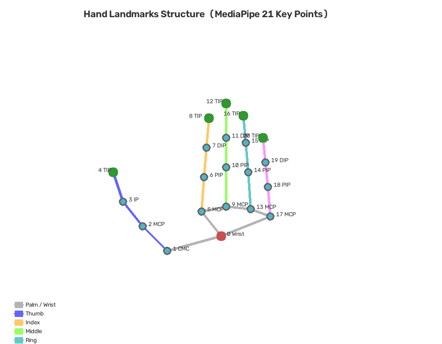

# Smart Finger 🖐️

基于 **MediaPipe 21 关键点** + **轨迹分析** + **神经网络** 的实时手势交互系统。

## 功能

| 手势 | 操作 | 识别方式 |
|------|------|----------|
| 五指合并 (张开→聚拢) | 全屏截图 | 轨迹分析 + 指尖分散度 |
| 三指向下 (食中无伸直, 拇尾勾) | 返回桌面 | 每指角度 + 手掌朝向 |
| Closed_Fist / Open_Palm / Pointing_Up / ... | 实时显示 | MediaPipe NN 分类器 |
| 自定义手势 (训练后) | 自定义 | RandomForest / PyTorch MLP |

## 项目结构

```
Smart Finger/
├── smart_finger.py              # 主程序 — 轨迹分析 + NN + 自定义模型
├── gesture_data_collector.py    # 数据采集器 (录制手势用于训练)
├── gesture_trainer.py           # 模型训练器 (RF / MLP + 交叉验证)
├── hand_structure_diagram.py    # 手部21关键点架构图生成器
├── hand_tracker.py              # (旧版) 基础手部追踪
├── hand_structure_diagram.png   # 手部架构图
├── requirements.txt
├── .gitignore
└── README.md
```

## 手部 21 关键点架构



MediaPipe 输出 21 个手部关键点 (WRIST, THUMB→PINKY 各 4 点), 本系统基于此进行:
- 每根手指的 **伸展 / 弯曲 / 角度** 独立轨迹追踪
- 指尖集合的 **分散度 / 聚拢速度** 分析
- 手掌 **朝向向量** 计算

## 快速开始

```bash
# 1. 安装依赖
pip install -r requirements.txt

# 2. 下载 MediaPipe 模型 (自动, 或手动)
python -c "import urllib.request; urllib.request.urlretrieve(
  'https://storage.googleapis.com/mediapipe-models/hand_landmarker/hand_landmarker/float16/latest/hand_landmarker.task',
  'hand_landmarker.task')"

# 3. 启动主程序
python smart_finger.py

# 按 ESC 退出 | 按 1 显示手部架构图
```

## 训练自定义手势

```bash
# 1. 采集数据
python gesture_data_collector.py
#   数字键 0-9: 切换手势类别
#   SPACE: 录制当前帧
#   H: 连续录制
#   S: 保存

# 2. 训练模型
python gesture_trainer.py
#   自动做 K-Fold 交叉验证 + 混淆矩阵 + 干扰分析

# 3. 启动主程序 (自动加载训练好的模型)
python smart_finger.py
```

## 神经网络架构

`gesture_trainer.py` 支持两种模型:

| 模型 | 类型 | 优势 |
|------|------|------|
| Random Forest | 树集成 | 小数据量鲁棒, 可解释性强 |
| PyTorch MLP | 3层全连接 (128→64→32) | 可定制, 适合大数据 |

MLP 结构:
```
Input (63) → Linear(128) → BN → ReLU → Dropout
           → Linear(64)  → BN → ReLU → Dropout
           → Linear(32)  → ReLU
           → Linear(N_classes)
```

## 干扰处理

- **置信度门限**: 低于 0.55 归类为 `rest`
- **时序平滑**: 最近 5 帧多数投票, 一致性 < 60% 视为干扰
- **K-Fold 交叉验证**: 评估模型在不同数据子集上的稳定性
- **混淆矩阵分析**: 找出最易混淆的手势对

## 开源参考

- [MediaPipe](https://github.com/google/mediapipe) — Google 手部关键点检测
- [scikit-learn](https://scikit-learn.org/) — Random Forest 分类器
- [PyTorch](https://pytorch.org/) — MLP 神经网络
